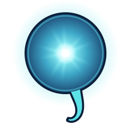
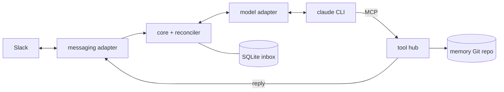

# noctiluca

A minimal, self-hosted agent harness. One process connects one agent to a chat platform (Slack today) and a model CLI (Claude Code today), keeps its work in SQLite and its memory in Git. An optional nightly job reviews its mistakes and fixes its memory.

- [Running](docs/running.md): build, configure, run, test, release
- [Architecture](docs/architecture.md): components, message flow, interfaces
- [Design decisions](docs/design.md): what was decided and why

noctiluca is licensed under the [MIT License](LICENSE). [THIRD_PARTY_NOTICES.md](THIRD_PARTY_NOTICES.md) credits the projects and papers it draws on.
