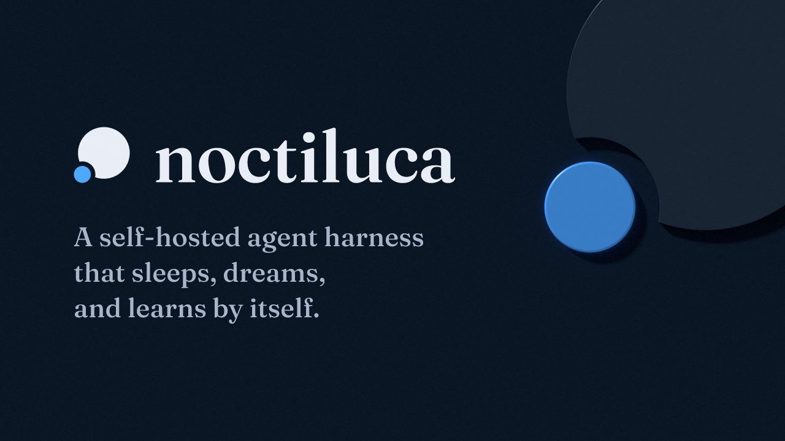
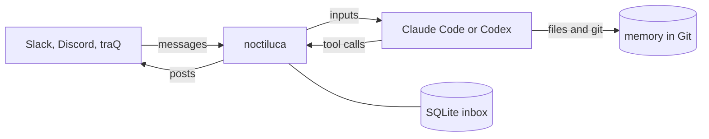

# noctiluca

noctiluca is a minimal, self-hosted agent harness.
One process runs one agent as a chat bot on Slack, Discord, or [traQ](https://github.com/traPtitech/traQ). The agent is a model CLI, Claude Code or Codex, on your own subscription.

- **One session.** Every conversation, scheduled task, and background result reaches the same model session, so the agent answers with the whole state in view.
- **Durable inbox.** Each message and task is a row in SQLite. A row that fails is retried, and a row that keeps failing is reported to you.
- **Memory in Git.** Memory is Markdown files that the agent edits with the CLI's file tools, and every change has a diff.
- **Rest.** An optional nightly procedure turns your corrections into general rules, restructures memory, and starts the session over with an empty context.

- [Running](docs/running.md): install, configure, and run it.
- [Design](docs/design.md): how it works and why.

noctiluca uses the [MIT License](LICENSE). [THIRD_PARTY_NOTICES.md](THIRD_PARTY_NOTICES.md) credits the projects and papers behind it.
