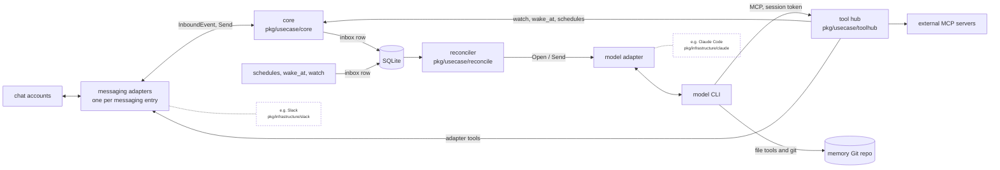
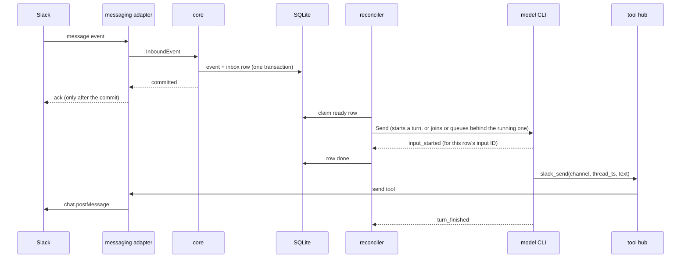

# Architecture

One noctiluca process runs one agent. The core knows no platform or model names: each messaging adapter translates one chat account (Slack, Discord, or traQ), and a model adapter translates a model CLI (the Claude CLI or the Codex CLI).



## A message, end to end

The diagram follows a Slack event that passes the filter described in [Conversation events](running.md#conversation-events). The adapter acknowledges dropped events without calling the core or writing to the database.



Only tools post. The model's final text is never sent, so a silent turn posts nothing.

A row counts as delivered when the model reports that it started on the row's input, not when `Send` returns. The reconciler sends each due input without waiting for earlier inputs to start.

## Sessions

Every instance uses one model session, `main`, for all accepted chat inputs, scheduled tasks, `watch` outcomes, and `wake_at` notes.
A model process is one run of the model CLI, and it resumes `main` from the saved token.
The reconciler sends due rows in the order they arrived, without priorities.
An input that arrives during a turn joins that turn.
Owner notices use separate, model-less `notice:` processes.

Chat headers name the place, sender, and local time, with ordering context.
Each adapter formats a location line with the native IDs its send tool takes.
Watch results and wake notes arrive as plain inputs without posting targets.

The model always runs in `model.workdir`.
A task header names the task and adds `workdir: <path>` if the task names a different workdir.
The `trust` and conversation rules ([running.md](running.md#configure)) apply to each input.

One turn runs at a time, so a long foreground step delays every conversation.
Long work can leave the turn through native background tools or `watch`.
The `watch` tool runs a command and sends its exit code and output to `main` as a new input.
Codex background commands never wake the model, so the Codex adapter tells the model to use `watch`.
When a Codex subagent finishes while `main` has no turn, the adapter starts a parent turn with a short completion note.
A subagent that finishes during a running turn needs no extra turn.
The `wake_at` tool sends a note to `main` at a given time.

A model process closes in these cases:

- `rest` requests a close and the process reaches idle.
- Input delivery fails, unless the model refuses the input.
- The reconciler fails to handle a model event.
- noctiluca stops or restarts.
- The model CLI exits or is killed.

The nightly `rest` schedule sends `procedures/rest.md` to `main` as a task input.
The model can also follow it during the day when it judges that its context needs a fresh start.
The core `rest` tool immediately clears the saved resume token and marks `main` to close at idle.
The process closes once no turn, waiting input, or native background work of the model CLI remains.
Inputs that arrive before that idle point still run in the old process.
This wait has no deadline.
Any process that opens after the call starts fresh, even if the old process never reached idle.
Completing the procedure without calling `rest` keeps the context.

## Work and failure

Every unit of work is an inbox row: a chat input, a schedule firing, a `wake_at` note, or a `watch` outcome.

- A row that fails to send, or that the model CLI refuses, is retried with backoff. A row whose model process closes before it starts, for example when noctiluca restarts, is sent again without counting an attempt. If noctiluca crashes before it records a start, that row is sent again.
- A turn that finishes with a failure sends the owner one notice, even if it covers several inputs. Its inputs do not run again.
- Delivery failures count against a budget of three attempts per row. After the third failed attempt the row is dead, and the owner gets one DM with the cause.
- Preparation (`Procedure` and `Prepare` together) times out after 30 minutes. An error or timeout fails only its row and sends the owner the notice for a dead row. The pump keeps running.
- Prompt assembly and each owner-notice delivery also time out after 30 minutes. These timeouts retry their rows with the delivery budget.
- noctiluca does not bound a turn. A command or tool call can run without output until the model CLI finishes the turn.
- After a restart, crash, or model exit, an interrupted turn continues once with a note. The note asks the model to finish each unfinished input using its posting instructions. A continuation cut short does not create another continuation.
- A failed row never stops the process. Only a failure of SQLite or of the tool-hub listener does.

## Interfaces

Core ↔ messaging adapter (`pkg/domain/messaging.go`):

```go
type MessagingAdapter interface {
	Start(ctx context.Context, consume func(context.Context, InboundEvent) error) error
	Send(ctx context.Context, to ConversationRef, msg OutboundMessage) (messageID string, err error)
	Tools() []Tool     // platform operations, offered to the model through the tool hub
	ToolNotes(context.Context) string // usage notes and the owner DM channel, added to the prompt
	Shutdown(context.Context) error
}
```

Each adapter is a named entry under `messaging` in the config. The core reads only the first segment of a `ConversationRef`, which is the entry's name, to select the adapter for input lookups and accept rules. The rest of the ref is opaque, and only that adapter interprets it. An adapter's tools carry the same name as a prefix (`slack_send` for an entry named `slack`).

`InboundEvent` carries the conversation and its parent, the sender (human or bot), text, attachments, and whether the agent is mentioned. An adapter can also implement `SourceInfoProvider` (readable names and a location line with native IDs for input headers), `UserGroupProvider` (group membership for accept rules), `DirectMessageProvider` (the owner's DM, for notices), and `ConversationFilter` (skips remote lookups in ignored conversations).

Core ↔ model adapter (`pkg/domain/model.go`):

```go
type ModelAdapter interface {
	Open(ctx context.Context, cfg ModelSessionConfig) (ModelSession, error) // session key, resume token, prompt, tool-hub URL + token, workdir
}

type ModelSession interface {
	Send(ctx context.Context, in UserInput) error // also during a turn: the adapter adds it to the running turn or queues it
	Events() <-chan ModelEvent                    // input_started, input_refused, turn_started, text, tool_call, tool_result, background_done, turn_finished, error
	ResumeToken() string
	Idle() bool
	Close() error
}
```

The model never receives tool definitions directly. It gets the tool hub's URL and a bearer token for its session. The token stays valid until the session closes, so background subagents keep their tools after a turn ends.

## State

| Where | What |
|---|---|
| SQLite | events and sends (with full-text search), inbox, sessions and resume tokens, schedules, watches, OAuth tokens |
| memory Git repo | `owner/` (the owner's handwritten files) and the agent's `core.md`, both loaded into the system prompt when a model process opens. Any other path is read on demand. |

## Trust model

Any human or bot that reaches the agent starts turns: in DMs, in every channel the bot is in, and on traQ in mentions elsewhere. Anyone who can add the bot to a channel widens that set. A `messaging` entry's optional `trust` narrows it to an allowlist, and the owner is always on it. A conversation override can replace that trust, require a mention, or ignore the conversation. A sender that the adapter reports as neither human nor bot never starts a turn. Configuration: [running.md](running.md#configure).

For every input, `main` uses the hub's tools, external MCP tools, and the model CLI's native tools. The model CLI allows every permission prompt. Native tools run as the Unix user that runs noctiluca, because reviews and builds need a shell. The model judges what to change.

Only the prompt tells the model to leave `owner/` untouched, and its native tools can still write there.

Claude defines a `worker` subagent that cannot use the messaging adapters' chat-writing tools: send, upload, react, unreact, and set status. Read tools and downloads remain available. This restriction does not cover forks or other subagent types. Codex ignores the chat-writing tool list.

Owner notices use `DirectMessageProvider` and `Send` on the first `messaging` entry. Model posts use each adapter's send tool. Each adapter's prompt notes name its owner's DM channel. Input headers append ` (owner)` to a sender whose ID matches the `owner` of the entry the message came from, so the model knows who the owner is. The marker grants no permission.

Real isolation needs a separate Unix user for the model, without access to noctiluca's config, tokens, and database. It is out of scope.
