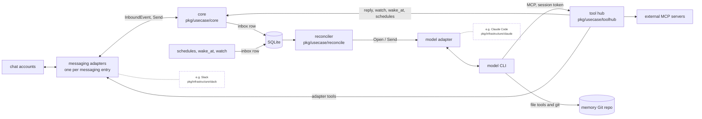
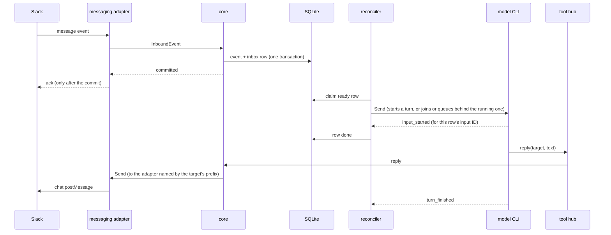

# Architecture

One noctiluca process runs one agent. The core knows no platform or model names: each messaging adapter translates one chat account (Slack, Discord, or traQ), and a model adapter translates a model CLI (the Claude CLI or the Codex CLI).



## A message, end to end

The diagram follows a Slack event that passes the filter described in [Conversation events](running.md#conversation-events). The adapter acknowledges dropped events without calling the core or writing to the database.



Only tools post. The model's final text is never sent, so a silent turn posts nothing.

A row counts as delivered when the model reports that it started on the row's input, not when `Send` returns. A conversation sends each input as it arrives, without waiting for earlier inputs to start.

## Sessions

- A channel is one session: its top-level posts and all its threads. A DM is one session per peer. Each scheduled task (heartbeat, cron job, consolidation) runs in its own session.
- Chat and watch/wake inputs name the place, sender, and local time, with ordering context and copyable `reply` and `work` targets. `reply` always takes an explicit target.
- A session's turns run one at a time, so the shipped tool notes tell the model to move long work out of the turn: into Claude's own `run_in_background` Bash or Agent, or into the `watch` tool, which runs a command and sends its exit code and output to the session as a new input. Codex's background commands never wake the model, so the Codex adapter tells the model to use `watch`. `wake_at` sends a note to the session at a given time. The turn then ends in seconds.
- Model processes are disposable. An idle one closes after `model.idle_timeout`. The next input resumes it from the saved resume token.

## Work and failure

Every unit of work is an inbox row: a chat input, a schedule firing, a `wake_at` note, or a `watch` outcome.

- A row that fails to send, or that the model refuses, is retried with backoff. A row whose model process closes before it starts, for example when noctiluca restarts, is sent again without counting an attempt. If noctiluca crashes before it records a start, that row is sent again.
- After three failed attempts a row is dead, and the owner gets one DM about that row.
- Conversation turns are cut at `model.turn_timeout` (2 h), task turns at `tasks.timeout` (30 min).
- A turn cut short by a restart, crash, or model exit continues once with a note. In a conversation, the note asks the model to finish each unfinished input at that input's own reply or work target. A turn cut at its timeout does not continue. Tasks notify the owner.
- Conversation sessions run concurrently. Scheduled tasks run one at a time.
- A failed row never stops the process. Only a failure of SQLite or of the tool-hub listener does.

## Interfaces

Core ↔ messaging adapter (`pkg/domain/messaging.go`):

```go
type MessagingAdapter interface {
	Start(ctx context.Context, consume func(context.Context, InboundEvent) error) error
	Send(ctx context.Context, to ConversationRef, msg OutboundMessage) (messageID string, err error)
	Tools() []Tool     // platform operations, offered to the model through the tool hub
	ToolNotes() string // short usage notes added to the prompt
	Shutdown(context.Context) error
}
```

Each adapter is a named entry under `messaging` in the config. The core reads only the first segment of a `ConversationRef`, which is the entry's name, and routes `Send`, the `reply` tool, and lookups to the adapter with that name. The rest of the ref is opaque, and only that adapter interprets it. An adapter's tools carry the same name as a prefix (`slack_send` for an entry named `slack`).

`InboundEvent` carries the conversation and its parent, the sender (human or bot), text, attachments, and whether the agent is mentioned. An adapter can also implement `SourceInfoProvider` (readable channel and sender names for input headers), `UserGroupProvider` (group membership for accept rules), `DirectMessageProvider` (the owner's DM, for notices), and `ConversationFilter` (skips remote lookups in ignored conversations).

Core ↔ model adapter (`pkg/domain/model.go`):

```go
type ModelAdapter interface {
	Open(ctx context.Context, cfg ModelSessionConfig) (ModelSession, error) // session key, resume token, prompt, tool-hub URL + token, workdir
}

type ModelSession interface {
	Send(ctx context.Context, in UserInput) error // also during a turn: the adapter adds it to the running turn or queues it
	Events() <-chan ModelEvent                    // input_started, input_refused, turn_started, text, tool_call, tool_result, background_done, turn_finished, error
	ResumeToken() string
	Idle() bool
	Close() error
}
```

The model never receives tool definitions directly. It gets the tool hub's URL and a bearer token for its session. The token stays valid until the session closes, so background subagents keep their tools after a turn ends.

## State

| Where | What |
|---|---|
| SQLite | events and sends (with full-text search), inbox, sessions and resume tokens, schedules, watches, OAuth tokens |
| memory Git repo | `owner/` (the owner's handwritten files) and the agent's `core.md`, both loaded into the system prompt when a model process opens. Any other path is read on demand. The heartbeat and consolidation send `procedures/heartbeat.md` and `procedures/consolidate.md` as their input. |

## Trust model

Each `messaging` entry's `trust` decides whose messages start turns, in DMs, in every channel the bot is in, and on traQ in mentions elsewhere, so anyone who can add the bot to a channel extends where it applies. The owner is always trusted. A conversation override can replace that trust, require a mention, or ignore the conversation.

Every session, scheduled tasks included, gets the same tools: the hub's tools, external MCP tools, and the model CLI's native tools with every permission prompt allowed. Native tools run as the Unix user that runs noctiluca, because reviews and builds need a shell. The model judges what to change.

Only the prompt tells the model to leave `owner/` untouched, and its native tools can still write there.

Owner notices, and replies whose target is the literal `owner`, go to the `owner` of the first `messaging` entry. Input headers append ` (owner)` to a sender whose ID matches the `owner` of the entry the message came from, so the model knows who the owner is. The marker grants no permission.

Real isolation needs a separate Unix user for the model, without access to noctiluca's config, tokens, and database. It is out of scope.
