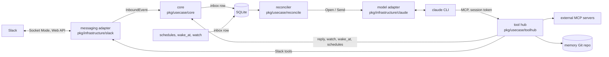
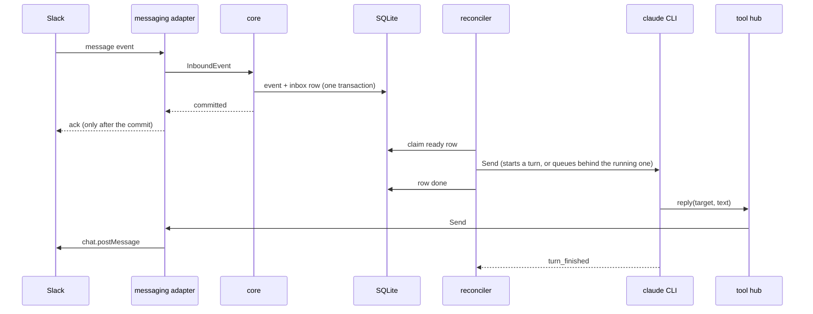

# Architecture

One noctiluca process runs one agent. The core knows no platform or model names: a messaging adapter translates Slack, and a model adapter translates the Claude CLI.



## A message, end to end

The diagram follows an event that passes the filter described in [Conversation events](running.md#conversation-events). The adapter acknowledges dropped events without calling the core or writing to the database.



Only tools post. The model's final text is never sent, so a silent turn posts nothing.

## Sessions

- A channel is one session: its top-level posts and all its threads. A DM is one session per peer. Each scheduled task (heartbeat, cron job, consolidation) runs in its own session.
- Chat and watch/wake inputs name the place, sender, and local time, with ordering context and copyable `reply` and `work` targets. `reply` always takes an explicit target.
- A session's turns run one at a time, so the shipped tool notes tell the model to move long work out of the turn: Claude's own `run_in_background` Bash or Agent, or the `watch` tool, which runs a command and sends its exit code and output to the session as a new input. `wake_at` sends a note to the session at a given time. The turn then ends in seconds.
- Model processes are disposable. An idle one closes after `model.idle_timeout`. The next input resumes it from the saved resume token.

## Work and failure

Every unit of work is an inbox row: a chat input, a schedule firing, a `wake_at` note, or a `watch` outcome.

- A row is retried, with backoff, only until `Send` hands it to the model. Then it is marked done and not sent again. A crash between `Send` and that commit can repeat one delivery.
- After three failed attempts a row is dead, and the owner gets one DM about that row.
- Conversation turns are cut at `model.turn_timeout` (2 h), task turns at `tasks.timeout` (30 min).
- Conversation sessions run concurrently. Scheduled tasks run one at a time.
- A failed row never stops the process. Only a failure of SQLite or of the tool-hub listener does.

## Interfaces

Core ↔ messaging adapter (`pkg/domain/messaging.go`):

```go
type MessagingAdapter interface {
	Start(ctx context.Context, consume func(context.Context, InboundEvent) error) error
	Send(ctx context.Context, to ConversationRef, msg OutboundMessage) (messageID string, err error)
	Tools() []Tool     // platform operations, offered to the model through the tool hub
	ToolNotes() string // short usage notes added to the prompt
	Shutdown(context.Context) error
}
```

`ConversationRef` is an opaque string that only the adapter interprets. `InboundEvent` carries the conversation and its parent, the sender (human or bot), text, attachments, and whether the agent is mentioned. An adapter can also implement `UserGroupProvider` (group membership for accept rules), `DirectMessageProvider` (the owner's DM, for notices), and `ConversationFilter` (skips remote lookups in channels without a rule).

Core ↔ model adapter (`pkg/domain/model.go`):

```go
type ModelAdapter interface {
	Open(ctx context.Context, cfg ModelSessionConfig) (ModelSession, error) // session key, resume token, prompt, tool-hub URL + token, workdir
}

type ModelSession interface {
	Send(ctx context.Context, in UserInput) error // also during a turn: the Claude CLI queues it as the next turn
	Events() <-chan ModelEvent                    // turn_started, text, tool_call, tool_result, background_done, turn_finished, error
	ResumeToken() string
	Idle() bool
	Close() error
}
```

The model never receives tool definitions directly. It gets the tool hub's URL and a bearer token for its session. The token stays valid until the session closes, so background subagents keep their tools after a turn ends.

## State

| Where | What |
|---|---|
| SQLite | events and sends (with full-text search), inbox, sessions and resume tokens, schedules, watches, OAuth tokens |
| memory Git repo | `owner/` (the owner's handwritten files) and `core.md`, both loaded into the system prompt when a model process opens. Any other path is read on demand. The heartbeat and consolidation send `procedures/heartbeat.md` and `procedures/consolidate.md` as their input. Every memory-tool write is one commit. |

## Trust model

`conversations.rules` decide whose messages start turns. Every session, scheduled tasks included, gets the same tools: the hub's tools, external MCP tools, and Claude's native tools with every permission prompt allowed. Native tools run as the Unix user that runs noctiluca, because reviews and builds need a shell. The model judges what to change.

The memory tools refuse writes, deletes, and reverts under `owner/`. This guards against mistakes, not against a session that edits those files through the shell.

Owner notices and the `owner` reply target go to the config's `owner` user. Input headers append ` (owner)` to that user's name so the model knows who the owner is; the marker grants no permission.

Real isolation needs a separate Unix user for the model, without access to noctiluca's config, tokens, and database. It is out of scope.
